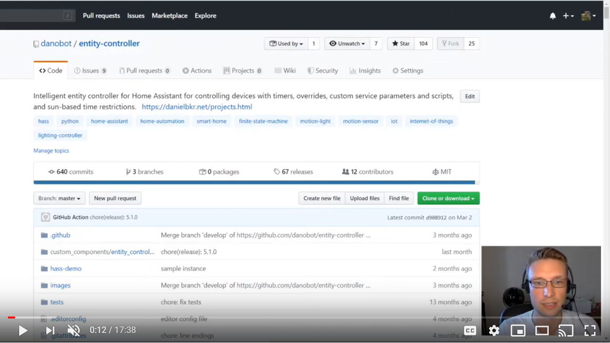

[](https://github.com/danobot/entity-controller/blob/develop/COPYING)
[](https://danielbkr.net/?utm_source=github&utm_medium=badge&utm_campaign=entity-controller)
[](https://paypal.me/danielb160)
[](https://gofund.me/7a2487d5)


# :wave: Introduction
Entity Controller (EC) is an implementation of "When This, Then That for x amount of time" using a finite state machine that ensures basic automations do not interfere with the rest of your home automation setup. This component encapsulates common automation scenarios into a neat package that can be configured easily and reused throughout your home. Traditional automations would need to be duplicated _for each instance_ in your config. The use cases for this component are endless because you can use any entity as input and outputs (there is no restriction to motion sensors and lights).

[Entity Controller Documentation](https://danobot.github.io/ec-docs/)

## Installation
Entity Controller requires Home Assistant **2025.3 or later**. Install it through HACS and restart Home Assistant. Go to **Settings → Devices & services → Add integration** and add **Entity Controller** once. Open the integration and select **Add controller** for each set of sensors and entities you want to manage together.

Open **Reconfigure controller** to see its saved configuration at a glance. The form opens with entities, timer and active hours visible. Expand the other sections to edit override settings, manual blocking, brightness, transitions or night mode, then select **Save** once to apply your changes.

For a motion-controlled light that turns off five minutes after the last sensor clears, choose **Sustained presence**, enter a five-minute delay and enable **Restart the timer when a sensor clears**. Active hours accept clock times and solar expressions such as `sunset - 00:30:00` and `sunrise + 00:30:00`.

Each controller exposes its state as an `entity_controller.*` entity, including the last transition and the timer deadline when a timer is running. Use **Download diagnostics** on the integration entry for the latest 25 state changes per controller. Saving settings for one controller lets the others continue running. The edited controller keeps its timer deadline when it remains active with the same targets.

### Upgrading and importing YAML

At startup, previously configured controllers move into the shared integration, preserving their saved settings and entity IDs. YAML controllers are imported as subentries too. In this example, the key `motion_light` preserves the controller's original identity in the entity registry.

```yaml
entity_controller:
  motion_light:
    sensor: binary_sensor.living_room_motion
    entity: light.tv_led
    delay: 5
```

Once imported, edit the controller from **Reconfigure controller**. You can remove its YAML block after verifying the import. The `entity_controller.reload` action imports newly added YAML controllers. A controller still listed in YAML will be imported again if you remove its subentry.
## :clapper: Video Demo
I created the following video to give a high-level overview of all EC features, how they work and how you can configure them for your use cases.

[](https://youtu.be/HJQrA6sFlPs)

## Support
Maintaining and improving this integration is very time consuming because of the sheer number of supported use cases. If you use this component in your home please donate a few dollars or check the issue tracker to help with the investigation of defects or the implementation of new features. I would be happy to receive your pull request.

[](https://paypal.me/danielb160)
[](https://gofund.me/7a2487d5)

# Contributions
All contributions are welcome, including raising issues. Expect to be involved in the resolution of any issues. 

The `close-issue` bot is ruthless. Please provide all requested information to allow me to help you.


